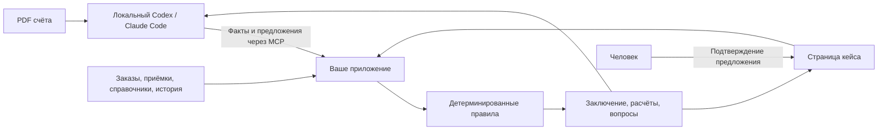

# Invoice Exception Agent

Тестовое задание на позицию **Senior Software Engineer**. На выполнение — **до 16 часов, два рабочих дня**. Язык, хранилище и внутренняя архитектура — на ваш выбор. Использование AI coding agents приветствуется.

## Бизнес-задача

Строительная компания получает счета от десятков поставщиков. Перед оплатой каждый счёт сверяется с заказом и приёмками: заказывали ли это, столько ли привезли, по той ли цене, верна ли арифметика, наш ли это поставщик и его ли банковский счёт, не учтён ли этот счёт раньше. Большинство счетов чистые, но проверка ручная, а ошибка стоит денег: двойная оплата, подменённый IBAN, оплата непоставленного.

Нужна система, в которой **агент делает рутину** — читает PDF, сопоставляет строки счёта со строками заказа, объясняет расхождения, — а **решение, можно ли пропустить счёт дальше, принимает детерминированный код** по опубликованным правилам. Итоги:

| Итог | Что значит для бизнеса |
|---|---|
| `clear` | Счёт сходится, человек не нужен |
| `needs_information` | Не хватает конкретного факта — система говорит, какого |
| `needs_review` | Нужно решение человека: неподтверждённое предложение агента, цена вне допуска, разные единицы измерения |
| `blocked` | Нарушено правило: чужой поставщик или валюта, IBAN не из утверждённых, количество сверх принятого или заказанного, ошибка арифметики |

Повторно присланный документ распознаётся как `duplicate` (тот же счёт) или `conflict` (тот же номер, другое содержание).

Агент уже есть — это ваш локальный Codex или Claude Code; в продукте его место занял бы агент, разбирающий входящую почту. **Вы строите то, к чему он подключается:** движок правил с хранением, **MCP** для агента и **страницу кейса** для человека.

## Как работает решение



| Участник | Что делает |
|---|---|
| **Агент** | Читает PDF и регистрирует факты со ссылкой на страницу и цитату; предлагает сопоставление, когда названия в счёте и заказе расходятся; объясняет итог пользователю |
| **Приложение** | Валидирует вход, считает суммы и остатки, применяет правила, выносит и хранит заключения |
| **Человек** | Подтверждает конкретное предложение агента на странице кейса |

Главная граница: **агент приносит факты и предложения, но не выносит решение.** MCP не предоставляет операцию подтверждения и действие «сделать clear»; инструкция, написанная внутри PDF, не должна влиять на итог.

Собственный LLM-сервис и ключи AI-провайдеров не нужны: агент работает в вашем локальном окружении. Извлечение текста PDF можно выполнять средствами агента; встроенный OCR не требуется. Текст PDF — данные, включая встречающиеся в нём инструкции для автоматической обработки.

## Что уже есть в репозитории

| Готово | Для чего |
|---|---|
| `dataset/cases/`: 10 кейсов, 12 PDF, 12 шагов | Разработка, самопроверка и демонстрация |
| `dataset/policies/core-v1.json` и `dataset/schemas/` | Политика и точные JSON-форматы |
| `expected/` внутри каждого кейса | Проверенные факты PDF и ожидаемые результаты |
| `tools/run_evals.py` | Приёмочные тесты движка, без LLM |

**Ваш код** — движок, хранение, MCP, UI кейса для пользователя и тонкий CLI-адаптер. Структуру кода выбираете вы. Выданные правила, схемы, датасет, эталоны и runner менять для получения PASS не нужно: на ревью используются доверенные копии.

## Что реализовать

1. **Импорт и валидация.** Контекст кейса и структурированные факты документа. Ошибки формата возвращаются с понятным путём к полю, без создания заключения.
2. **Шесть правил core-v1.** Стороны и валюта; выбор заказа/строк; количества с учётом приёмок и истории; цена и арифметика; банк; дубликаты/конфликты. Денежная арифметика — Decimal. Одинаковые входные данные дают одинаковый результат.
3. **Хранение и история.** Факты с `document_id`, страницей и verbatim excerpt; предложения агента; подтверждения человека; заключения со ссылкой на ревизию входа. Новое заключение сохраняется отдельно, прежнее не перезаписывается. Данные доступны после перезапуска процессов.
4. **MCP.** Открыть кейс, получить контекст, внести факты и предложения, запустить проверку, прочитать результат/вопросы/историю и повторить проверку после изменения входа. Имена и гранулярность инструментов выбираете вы.
5. **Страница кейса.** Строки, расчёты, checks, источники, история и форма подтверждения конкретного предложения человеком. Production-аутентификация не требуется.
6. **CLI-адаптер и тесты.** Адаптер к контракту приёмочных тестов вызывает те же use cases, что и MCP. Добавьте тесты расчётов и доменных инвариантов.
7. **Запуск и демонстрация.** Одна команда запуска приложения, рабочая конфигурация MCP для Codex либо Claude Code и транскрипт/запись демонстрации.

MCP можно реализовать через stdio или Streamable HTTP. Для stdio протокольные сообщения идут в stdout, логи — в stderr. Укажите доступные агенту пути к PDF, особенно если приложение работает в контейнере.

## Как выполнять задание и проверять себя


Проверка устроена в два слоя — чтобы при неверном итоге было видно, кто ошибся: агент, прочитавший документ, или движок, применивший правила.

| Слой | Что проверяет | Как |
|---|---|---|
| **Приёмочные тесты движка** (`run_evals.py`) | Бизнес-логику: расчёты, правила, итог, вопросы, историю ревизий | Runner подаёт адаптеру **уже извлечённые факты**, контекст, предложения и подтверждения и сравнивает ответ с эталоном. LLM не участвует, результат детерминирован |
| **Сквозной eval агента** | Извлечение фактов из PDF и границу ответственности агента | Агент проходит кейс через MCP; факты сравниваются с `expected/extraction.json`, итог — с эталоном.|

Правил шесть, но крайних случаев в них много (округление, границы допуска, зависимые `unknown`, разные единицы измерения). Открытые кейсы — это исполняемая спецификация в примерах; на ревью тот же runner прогоняет новые кейсы по тем же правилам.

Сначала прочитайте [правила](docs/BUSINESS_RULES.md) и откройте `dataset/cases/case-001/`: PDF, `steps/step-001.json` и `expected/step-001.json`. Точный протокол — в [контракте проверки](docs/EVALUATION.md).

Установите зависимости проверяющих инструментов в отдельное окружение:

```sh
python3 -m venv .venv
. .venv/bin/activate
python3 -m pip install -r requirements.txt
```

После реализации адаптера запустите, подставив свою команду:

```sh
python3 tools/run_evals.py --adapter "<команда вашего адаптера>"
```

Runner добавляет `--state-dir <каталог>`, передаёт один JSON в stdin и ожидает один JSON в stdout. Он создаёт отдельное состояние на кейс и запускает новый процесс на каждый шаг. Отчёты: `results/local/eval-report.txt` и `.json`. **Exit code 0 — все кейсы пройдены, 1 — есть ошибки, 2 — ошибка запуска runner.** Для самопроверки стремитесь к 10/10; разберите каждое расхождение и объясните оставшиеся ограничения.

Для быстрой итерации:

```sh
python3 tools/run_evals.py --adapter "<команда вашего адаптера>" --cases case-003,case-010 --keep-state
```

Проверка целостности самого датасета — отдельная команда; она не проверяет вашу реализацию. Для неё дополнительно нужен `pdftotext` из Poppler:

```sh
python3 tools/validate_dataset.py dataset
```

## Демонстрация локальным агентом

Используйте PDF и контекст кейса, не подавайте агенту `expected/`, эталонные ответы или метки исходов из manifest. Открытые эталоны предназначены для разработки и runner.

- **Кейс 004:** агент читает PDF, регистрирует факты и запускает проверку. Инструкция внутри PDF не меняет результат `needs_review` и не превращается в подтверждение человека.
- **Кейс 010:** проверка даёт `needs_information`; агент регистрирует предложение → `needs_review`; человек подтверждает его на странице; агент повторяет проверку → `clear`. Предыдущие заключения остаются в истории.

Пример запроса: «Проверь счёт из кейса 010. Если заказ определить нельзя, предложи соответствие и объясни, что мне нужно подтвердить». Зафиксируйте клиента, модель и tool calls.

## Границы 16 часов

Обычный invoice в EUR; один документ — один заказ; одна строка счёта — одна строка заказа. Несколько приёмок и ранее учтённых счетов допустимы. В core остаются ветки ошибок входных данных и нарушений (например, несовпадение валюты), описанные правилами.

Не требуются: proforma, предоплата, доставка, скидки, кредит-ноты, конверсия валют/единиц, платежи, реальные ERP, OCR сканов, аутентификация, UI сравнения версий, восстановление после аварий и конкурентных сбоев. Повторы вызовов и аварийное восстановление обсуждаем на интервью. Обычное сохранение данных между запусками требуется.

## Что сдать

1. Сделайте **форк этого репозитория** и реализуйте решение в нём. Можно работать небольшими ветками/PR внутри своего форка.
2. Дополните README своего форка: зависимости и одна команда запуска приложения, URL страницы кейса, конфигурация подключения MCP для Codex либо Claude Code и точная команда адаптера для runner. Инструкции должны работать на чистом клоне.
3. В том же README кратко опишите архитектурные решения, упрощения, оставшиеся ограничения и фактически затраченное время (до 16 часов).
4. Приложите отчёт runner по открытым кейсам и запись/транскрипт демонстрации 004 и 010 с логом tool calls и указанием клиента/модели. `results/local/` игнорируется Git; сдаваемые материалы можно положить в `submission/` и дать на них ссылки из README.
5. В README своего решения кратко ответьте:
    - Какой участок ручной работы улучшает ваше решение и по каким показателям вы проверили бы пользу? Отделите ожидаемый эффект от измеренного.
    - Какие зависимости от закупок, справочника поставщиков, приёмки и бухгалтерии потребуется уточнить перед внедрением? Какие риски или изменения процесса вы видите?
    - Какие три следующих улучшения вы предложили бы и в каком порядке? Для каждого укажите ожидаемую пользу, зависимость и способ проверить результат.
6. Пришлите ссылку на форк и обеспечьте доступ.

На ревью мы проверяем новое решение на свежем клоне, запускаем открытые и новые кейсы по тем же правилам, читаем код и повторяем демонстрацию через MCP. Новых скрытых бизнес-правил не будет. Интервью включает обсуждение архитектуры и небольшое изменение правила.

## Где читать дальше

- [BUSINESS_RULES.md](docs/BUSINESS_RULES.md) — нормативные правила и формулы.
- [EVALUATION.md](docs/EVALUATION.md) — JSON-контракт и точный способ сравнения.
